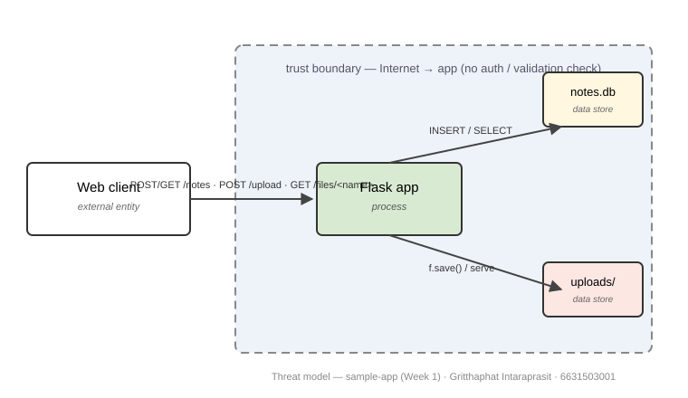
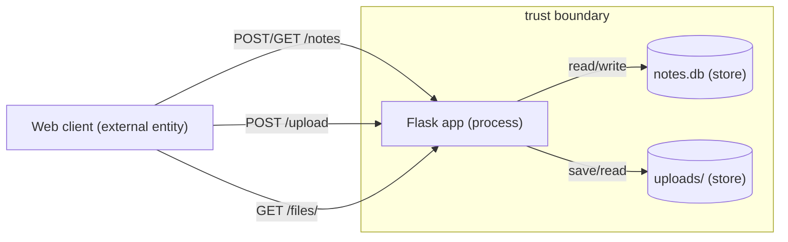

# Threat Model — sample-app (Week 1)

> Copy of `THREAT-MODEL-TEMPLATE.md`, filled for the Week-1 `sample-app`.
> **Student:** Gritthaphat Intaraprasit · 6631503001
> (Replace the DFD placeholder below with YOUR drawn DFD image — identity-stamped.)

## 1. Data-flow diagram

*Identity stamp to add: capture this diagram with your stamped terminal in the same frame, or overlay the stamp.*

Marked on the diagram: Web client (external entity) → Flask app (process) → `notes.db` + `uploads/` (stores), with the Internet→app trust boundary shown as a dashed line.

Reference layout (draw.io / paper): three boxes + two stores —
- **Web client** (external entity, left, *outside* the dashed boundary)
- **Flask app** (process, centre, *inside* the boundary)
- **`notes.db`** and **`uploads/`** (data stores, right, inside the boundary)

Flows to draw: `POST/GET /notes` (client ↔ app ↔ `notes.db`), `POST /upload`
(client → app → `uploads/`), `GET /files/<name>` (client → app ← `uploads/`).

Reference (renderable in any Mermaid viewer) — trace it into your drawing tool:

## 2. Elements & trust boundaries
| Element | Type (process/store/entity/flow) | Trust boundary crossed? |
|---|---|---|
| Web client | external entity | yes (Internet → app) |
| Flask app | process | inputs cross Internet→app with no auth/validation |
| SQLite DB (`notes.db`) | data store | yes (app→DB carries unvalidated, unauthenticated data) |
| `uploads/` store | data store | yes (app→uploads carries raw client filename) |

## 3. STRIDE analysis
| Element | S | T | R | I | D | E |
|---|---|---|---|---|---|---|
| /notes | Client sets `owner`, no auth → spoof any user | Anonymous caller can insert notes | No logging | GET returns ALL notes → disclosure | No rate/size limit | Client `owner` = act as any identity |
| /upload | No identity check on uploader | Raw `f.filename` joins save path → `../` escapes `uploads/` | No logging | Echoes client filename; write can land outside store | No size limit → disk exhaustion | Stored HTML may be served to victims |
| /files/<name> | — | Read side defended by `send_from_directory` | No access logging | Serves any file in `uploads/` | — | If uploads are executed → code exec |

## 4. Top 5 risks (likelihood × impact) + mitigation
1. **Arbitrary file write** `/upload` (High × High) → `secure_filename()` + extension allow-list *(implemented, commit `827093e`)*
2. **Unauthenticated read of all notes** `/notes` (High × High) → authenticate callers; scope reads to session owner
3. **Spoofable `owner`** `/notes` (High × Medium) → bind `owner` server-side from session
4. **No audit trail** (Medium × Medium) → request logging with actor + timestamp
5. **No size / rate limits** `/upload` (Medium × Medium) → upload size cap + rate limiting
