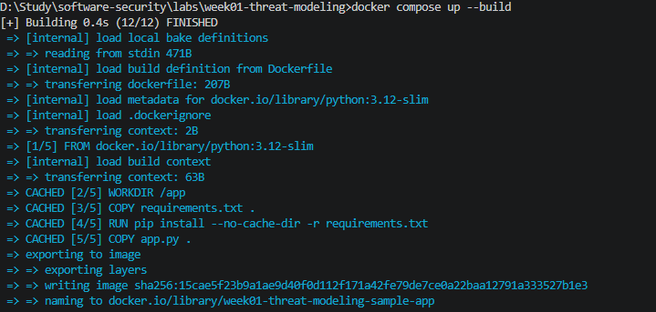
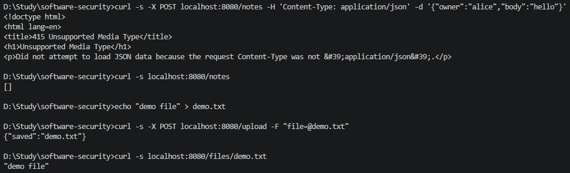

# Worksheet 1 — Security Mindset & Threat Modeling (3 hrs)

> **Course:** Software Security (KOSEN69) · **Week 1**
> **Aligned to:** OWASP 2025 A06 Insecure Design · CWE-501 (Trust Boundary Violation)
> **Signature game:** "Elevation of Privilege" (Microsoft STRIDE card deck)

> **Ethics note:** This week is *modeling only* — you analyze design, you do **not** attack the app. Run the sample app only on your own VM/localhost. Never apply these techniques to systems you do not own or lack written permission to test.

## Part 1 — Student Information
| Name | Student ID | Date | Group |
|---|---|---|---|
| Gritthaphat Intaraprasit | 6631503001 | [date] |  |

## Part 2 — Lecture Questions
Answer in your own words (2–4 sentences each).
1. Define the CIA triad and give one concrete failure example for each of the three properties.

*answer* Confidentiality means only authorised parties can read data — a failure: `/notes` returns every note to any anonymous caller. Integrity means only authorised parties can change data and it is not altered — a failure: a path-traversal upload overwrites `notes.db`. Availability means the service works when needed — a failure: unlimited uploads fill the disk and the app dies.
2. What is a *trust boundary*, and why does data crossing one deserve extra scrutiny?

*answer* A trust boundary is the line between two trust levels; anything crossing from the less-trusted side must be treated as attacker-controlled until it is validated or authenticated. In the sample app every request crosses the Internet→app boundary with no check, and the client-supplied `owner` is written straight into the database — a trust boundary violation (CWE-501).
3. Explain "attack surface." Name two things that increase it in a web app.

*answer* Attack surface is the set of all ways an outside party can interact with the system. Two things that widen it in this app: (1) unauthenticated write endpoints such as `POST /notes` and `POST /upload`, and (2) accepting attacker-chosen filenames that become filesystem paths. In general, more routes/APIs, uploads, third-party dependencies, and open ports all grow it.
4. What does each STRIDE letter map to, and which security property does each threat violate?

*answer* Spoofing → authentication; Tampering → integrity; Repudiation → non-repudiation/audit; Information disclosure → confidentiality; Denial of service → availability; Elevation of privilege → authorization.
5. What does "Secure by Design" (CISA) mean, and how does it differ from bolting security on after release?

*answer* Secure by Design (CISA) treats security properties as design inputs from the start — threat modeling, least privilege, and safe defaults such as the invariant "no user-supplied string ever becomes a path component". Bolting security on after release is the opposite: fixes get added after shipping, which is costlier, incomplete, and addresses one instance at a time. `/notes` shipped without auth because authentication was never a design requirement.

## Part 3 — Hands-on Lab (180 min)
**Learning goals:** build a data-flow diagram (DFD), apply STRIDE to a real Flask app, rank risks, and propose mitigations.
**Prerequisites:** Docker + Docker Compose in your VM; a drawing tool (draw.io / paper + photo); the Elevation of Privilege deck (print or virtual) — free print-and-play PDF at [github.com/adamshostack/eop](https://github.com/adamshostack/eop).

**Environment setup**
```bash
cd labs/week01-threat-modeling
docker compose up --build           # starts sample-app on http://localhost:8080
curl -s -X POST localhost:8080/notes -H 'Content-Type: application/json' \
     -d '{"owner":"alice","body":"hello"}'   # observe behavior, do not attack
curl -s localhost:8080/notes

echo "demo file" > demo.txt
curl -s -X POST localhost:8080/upload -F "file=@demo.txt"   # observe behavior, do not attack
curl -s localhost:8080/files/demo.txt
```

Source to model lives in `sample-app/app.py`. Template to fill: `THREAT-MODEL-TEMPLATE.md` (copy it, do not edit the original).

**What to submit per task:** the threat/element identified + a screenshot (DFD, table, or running app) + a 2–3 sentence mitigation.

**Task 0 — Onboarding (5 min)** · *Goal:* prove the environment works. *Steps:* `docker compose up`, hit `/notes` and `/files/<name>`, read `sample-app/app.py`. *Deliverable:* screenshot of the running app + the JSON response.



**Task 1 — Draw the DFD (25 min)** · *Goal:* map the system. *Steps:* identify the external entity (web client), the process (Flask app), the data store (`notes.db` SQLite), the `uploads/` store, and the flows for `/notes`, `/upload`, `/files/<name>`; mark the Internet→app trust boundary with a dashed line. *Deliverable:* DFD image embedded in your copy of the template.

**Task 2 — STRIDE the elements (30 min)** · *Goal:* enumerate threats per element. *Steps:* for each element fill the S/T/R/I/D/E grid. Ground it in real code: `/notes` accepts a client-supplied `owner` with no auth (Spoofing); `/upload` saves raw `f.filename` — arbitrary-file-write (Tampering) — and echoes the resolved save path back in its response (Information disclosure); `/files/<name>` reads it back but is comparatively defended (see Task 5); no logging anywhere (Repudiation). *Deliverable:* completed STRIDE table.

**My STRIDE grid (grounded in `sample-app/app.py`):**

| Element | S | T | R | I | D | E |
|---|---|---|---|---|---|---|
| `/notes` | Client sets `owner` freely, no auth → spoof any user | Any anonymous caller can insert a note | No logging of writes | `GET` returns **all** notes to anyone → disclosure of every owner's notes | No rate/size limit | Client-supplied `owner` = act as any identity |
| `/upload` | No identity check on who uploads | Raw `f.filename` joins the save path → `../` escapes `uploads/` (arbitrary file write) | No logging | Echoes the client filename back; crafted file can land outside the store | No size limit → disk exhaustion | A stored file (e.g. HTML) may later be served to victims |
| `/files/<name>` | — | Read side defended by `send_from_directory` (blocks `..`) | No access logging | Serves any file in `uploads/`, incl. attacker content | — | If uploads are ever executed, code execution follows |

**Task 3 — Elevation of Privilege game (20 min)** · *Goal:* find threats you missed. *Steps:* play the EoP deck against your DFD; each card you can tie to a real element/flow scores a point; record every valid threat. No printer or scissors? Draw from the digital deck below instead — same 78 cards, same rule. *Deliverable:* list of carded threats + score.

```sim
eop-deck
```

**Task 3b — Systems-level pass (25 min) 🔭** · *Goal:* find what the per-element grid cannot see. Tasks 2 and 3 enumerate threats **one element at a time**, and that is exactly where threat models are known to stop short — students taught STRIDE alone reliably identify component threats and *discount system-level ones* ([Joshi et al., ASEE 2024](https://arxiv.org/abs/2404.16632)). So do a second pass over the **whole** diagram:


- **Trust boundaries end-to-end.** Follow one request from the client to `notes.db` and back. List every boundary it crosses. Which crossing has no check on it?
- **Assume one element is fully owned.** Pick the Flask process, then the `uploads/` store. For each: what does the attacker now *reach* — not what is it, but where does it get them?
- **Chain two "low" findings.** Find two threats you or the EoP deck rated minor that combine into something you would not accept. Write the chain as `A → B → consequence`.
- **One-line system claim.** Finish: "Even if every element-level mitigation in Task 8 is implemented, this system still fails if ___."

Use the simulation below before you start — toggle a component to attacker-controlled and watch what it reaches:

```sim
trust-boundary
```

*Deliverable:* the boundary list, two owned-element reachability notes, one written chain, and the system claim.

*answer — boundaries end-to-end:* One `/notes` POST crosses Internet→app (no auth/validation on `owner`), then app→DB (the `INSERT`). There is no check at either boundary; the unguarded crossing is app→DB — because the first boundary never authenticates, any anonymous request becomes a DB write or read.

*answer — assume an element is owned:* If the **Flask process** is owned, the attacker reaches every note, every uploaded file, and (via the traversal write) the filesystem the container can write — the whole data tier. If the **`uploads/` store** is owned, the attacker reads every file, and if uploads are ever served or executed (HTML, or anything the app later runs), stored XSS or code execution follows. The point is reachability — where it gets you — not the element itself.

*answer — chain:* upload `../../notes.db` (rated minor alone) → overwrites the SQLite database → every user is served poisoned or fake notes. Written as `A (traversal upload) → B (notes.db overwritten) → consequence (data tampering / DoS for all users)`.

*answer — system claim:* Even if every element-level mitigation in Task 8 is implemented, this system still fails if **uploads and the database share a writable location, or any user-supplied string is ever joined into a path**.

**Task 4 — Abuse cases & attacker personas (20 min)** · *Goal:* think like specific adversaries. *Steps:* define 2 personas (e.g. a curious logged-in user; an anonymous internet attacker) and write 2 abuse cases each against the sample app, tied to DFD elements. *Deliverable:* 4 abuse cases.

*answer — persona 1: anonymous internet attacker*
1. `POST /notes` with `owner:"alice"` → plants a note in alice's name (spoofing; client→app→`notes.db`).
2. `GET /notes` → harvests every user's notes with no authentication (information disclosure; `notes.db`→app→client).

*answer — persona 2: mischievous / curious user*
1. Upload a file named `../../notes.db` → overwrites the store or breaks the app (tampering / DoS; client→app→`uploads/`).
2. Upload an HTML file and get it served from `/files/<name>` to other victims → stored-XSS seed (uploads/→app→client).

**Task 5 — Path-traversal deep-dive (25 min)** · *Goal:* analyze the riskiest flow. *Steps:* trace `/upload` → `/files/<name>`; explain how `../` in a filename escapes `uploads/`; sketch the secure design (`secure_filename`, store outside web root, allow-list extensions). *Deliverable:* the data flow + secure-design note.

*answer — data flow:* client `f.filename` → `os.path.join(UPLOAD_DIR, f.filename)` → `f.save(...)`. A filename of `../../notes.db` makes the join resolve outside `uploads/`, so the **write side is the hole** (arbitrary file write). The read side (`/files/<name>`) is comparatively defended: Flask's `send_from_directory` rejects `..` and confines reads to the folder.

*answer — secure-design note:* apply `werkzeug.utils.secure_filename()` so `..` and separators are stripped, store uploads in a directory outside the web root, allow-list extensions (txt/images…), and never echo the client filename. The invariant becomes "no user-supplied string ever becomes a path component" rather than patching one endpoint.

**Task 6 — Threat-model the project target (30 min)** · *Goal:* kick off your term project. *Steps:* stop the sample-app first (`docker compose down` — both apps bind host port 8080), then run **NoteVault** (`cd ../../project/starter-app && docker compose up`), draw a quick DFD, and list the top 3 STRIDE threats you'd investigate. *Deliverable:* NoteVault DFD + top-3 threats (reuse these in your project report — `project/REPORT-TEMPLATE.md` in the repo root).

*answer — top-3 STRIDE threats to investigate in NoteVault (`project/starter-app`):*
1. **Tampering / Elevation of privilege — unauthenticated SQL injection.** `/login` builds its query by string formatting and `/search` injects `q` into a `LIKE`; both let an attacker bypass auth or read other users' notes.
2. **Spoofing / Elevation of privilege — forged session token.** The JWT is decoded with `alg=none` allowed and signed with a hard-coded secret, so anyone can mint an "admin" token — and `/admin` then dumps the user table including MD5 password hashes.
3. **Information disclosure — weak credential storage + missing authz on reads.** Passwords are MD5-hashed, and `/api/notes/<id>` checks only that *someone* is logged in, not that they own the note, so any user can read notes by id.

*(DFD image for NoteVault: draw web client → Flask app → SQLite; boundary at the app.)*

**Task 7 — Security requirements (15 min)** · *Goal:* turn threats into testable requirements. *Steps:* write 3 security requirements as acceptance criteria ("the system must … so that …"), each mapped to a threat from Task 2 or Task 6. *Deliverable:* 3 testable security requirements.

*answer:*
1. "`/upload` must store only files whose sanitized name passes an extension allow-list, so that no client-supplied string can write outside the upload store." (from arbitrary file write)
2. "`/notes` must authenticate the caller and bind `owner` to the authenticated session, so that nobody can create or read notes as another user." (from spoofing / unauth disclosure)
3. "Every note write and file upload must be logged with actor and timestamp, so that actions are attributable." (from repudiation)

**Task 8 — Defend / fix it: rank & mitigate (25 min) 🛡️** · *Goal:* turn threats into action you can prove. *Steps:* rank the top 5 threats by likelihood × impact; propose one concrete mitigation each (e.g., auth on `/notes`, `secure_filename()` + allowlist for `/upload`, request logging for Repudiation, size/rate limits for DoS). Then **pick one and actually implement it** in your fork.

*Deliverable — the top-5 table, plus for the one you implemented:*
1. the **diff** (commit hash on your `wk01` branch),
2. **evidence it works**: the request that succeeded before your change and is refused after — both outputs,
3. **why it closes the class, not the instance** (2–3 sentences). `secure_filename()` on one endpoint is an instance fix; *"no user-supplied string ever becomes a path component"* is a class fix. Say which yours is, and if it's an instance fix, say what the class fix would be.

*answer — top-5 risks (likelihood × impact) + mitigation:*

| # | Threat | Element | Likelihood × Impact | Mitigation |
|---|---|---|---|---|
| 1 | Arbitrary file write via `../` filename | `/upload` | High × High | `secure_filename()` + extension allow-list (**implemented**, commit `827093e`) |
| 2 | Unauthenticated read of all notes | `/notes` GET | High × High | Authenticate callers; scope reads to the session owner |
| 3 | Spoofable `owner` | `/notes` POST | High × Medium | Bind `owner` server-side from the session |
| 4 | No audit trail | app-wide | Medium × Medium | Request logging (actor + timestamp) |
| 5 | No size / rate limits | `/upload` | Medium × Medium | Upload size cap + rate limiting |

*answer — implemented fix (commit `827093e` on `wk01`):* the diff in `sample-app/app.py`:
```diff
+from werkzeug.utils import secure_filename
+
+ALLOWED_EXTENSIONS = {"txt", "png", "jpg", "jpeg", "gif", "md"}
+
+def allowed_file(name):
+    return "." in name and name.rsplit(".", 1)[1].lower() in ALLOWED_EXTENSIONS
+
 @app.route("/upload", methods=["POST"])
 def upload():
     f = request.files["file"]
-    f.save(os.path.join(UPLOAD_DIR, f.filename))
-    return {"saved": f.filename}
+    name = secure_filename(f.filename or "")
+    if not name or not allowed_file(name):
+        return jsonify(error="filename rejected"), 400
+    f.save(os.path.join(UPLOAD_DIR, name))
+    return {"saved": name}
```

*answer — evidence it works (verified by running before/after):*
- **Before:** `curl -X POST localhost:8080/upload -F "file=@demo.txt;filename=../../evil.sh"` → `{"saved":"../../evil.sh"}`, and the file was written to `/evil.sh` (outside `/app/uploads`, which stayed empty).
- **After:** the same request → `{"error":"filename rejected"}` (HTTP 400). A traversal `.txt` (`../../notes_backup.txt`) is now stored sanitized as `notes_backup.txt` inside `/app/uploads` — nothing escapes.

*answer — class vs instance:* this closes the **class**: `secure_filename()` strips `..` and separators before the join, so no client-supplied string can ever become a path component, and the allow-list caps what may be stored at all — not just this one payload. What could still break it: a name collision inside the store, a symlink planted in `uploads/`, or another endpoint (e.g. `/notes`) that still trusts client input.

> **Why this is weighted.** Fewer than half of working developers can spot a security hole in code, and being shown vulnerabilities does not by itself teach you to find or close them. Exploiting is the half that feels like progress; defending is the half that transfers to your job.

## Part 4 — Reflection
1. Map your top finding to a CWE and to OWASP A06 (Insecure Design); explain the mapping in one sentence.

*answer* Arbitrary file write via `/upload` → **CWE-22 (Path Traversal)** → OWASP 2025 **A06: Insecure Design**, because the design trusted a client-supplied string as a path component instead of enforcing "no user string ever becomes a path" as an invariant.

2. Name one real-world breach caused by a design flaw (not a missing patch) and what design control would have prevented it.

*answer* Facebook 2021 phone-number scraping (~500M users): the contact-import API was designed to return account data for arbitrary phone numbers; purpose-limitation, authentication, and rate limits on bulk lookups would have prevented it. (Alternative: Capital One 2019 — an SSRF that reached cloud metadata because egress/metadata weren't separated into trust zones by design.)

3. Of your five mitigations, which gives the most risk reduction per unit of effort, and why?

*answer* `secure_filename()` + allow-list on `/upload` — a couple of lines removes the highest likelihood × highest impact threat (arbitrary file write), while real auth on `/notes` needs whole-app machinery (sessions, middleware, tests) for comparable risk reduction.

## Grading rubric (100)
| Criterion | Points |
|---|---|
| Lecture questions (Part 2) | 20 |
| Exploitation + evidence (DFD + STRIDE table + EoP findings + screenshots) | 40 |
| Defense (top-5 ranking + mitigations) | 25 |
| Reflection (CWE/OWASP mapping + breach + best mitigation) | 15 |

**Assessed within the rows above** (they are not extra points — they are what those points are for):
- **Systems-level reasoning** (inside *Exploitation + evidence*, Task 3b): does the model reach past single elements to boundaries, reachability and chains? Scored with the STRIDE + systems-thinking rubrics of [Joshi et al. 2024](https://arxiv.org/abs/2404.16632).
- **Defensive proof** (inside *Defense*, Task 8): a claimed mitigation with no before/after evidence scores at most half. A mitigation you can show closing a *class* scores full.
- **Adversarial thinking** (across the whole sheet): do the abuse cases, personas and chains show you reasoning as an attacker with goals and constraints — or just listing categories? This is the course's central disposition and it is assessed, not assumed.

---

## Evidence & Integrity (required)

- **Identity proof:** every screenshot/diagram must show a terminal running `printf '%s | %s | ' "$(whoami)" '<YOUR-STUDENT-ID>'; date '+%F %T %Z'` **in the
  same image as the evidence**. When the evidence is a browser page, a DevTools panel or a
  rendered response, put that terminal **beside the browser and capture the whole screen** — a
  cropped window carries nothing that identifies you, and the lab's own output is
  byte-identical for the whole cohort *by design*, so the stamp is the only thing that makes
  the shot yours. Generic or borrowed evidence is not accepted.
- **Personalized flag (if this lab issues one):** ____________________
  *Flags are unique per student — submitting another student's flag is a violation. How to submit: **learn.zcr.ai/submit** (full guide: `SUBMISSION.md` in the repo root).*
- **Explain in your own words** *(graded on your reasoning, not copied text):*
  1. What did you do, and **why did the vulnerability work**?

  *answer* I ran the Week-1 sample app, mapped it with STRIDE, and (Task 8) demonstrated a traversal upload writing outside `uploads/`, then applied `secure_filename()`. The vulnerability worked because the app trusted the filename from the request and joined it straight into the save path, so `..` made the write resolve outside the intended folder.

  2. **Why does your fix actually stop it** — and what could still break it?

  *answer* The fix stops it by sanitizing the name before the join — `secure_filename()` strips `..` and separators — and refusing anything not on the extension allow-list, so the client string can no longer influence the path. What could still break it: sanitization doesn't fix the other trust issues (unauthenticated `/notes`, no logging), and a symlink planted inside the store or an outdated allow-list would each open a different hole.

---

## 🤖 Audit the AI (required)

AI is a power tool you must **distrust** — you are graded on your *critique*, not the AI's answer.

1. Ask an AI assistant to exploit **or** fix this week's vulnerability. Paste its full answer.

*Pasted AI answer (asked to fix the path traversal in `/upload`):* "Strip the dangerous part before saving:
```python
f = request.files["file"]
name = f.filename.replace("../", "")
f.save(os.path.join(UPLOAD_DIR, name))
return {"saved": name}
```
Removing `../` stops the file from escaping the folder."

2. **Find what's wrong or risky** in it — insecure code, a subtly incomplete fix, a hallucinated API/function/CVE, a missed edge case, or wrong reasoning. Quote the exact line(s).

*What's wrong:* the fix is bypassable. The line `name = f.filename.replace("../", "")` is defeated by `....//` — removing the inner `../` from `....//` leaves `../`, which still escapes. It also ignores absolute paths, backslashes, and does nothing to restrict *what* may be stored.

3. Produce the **correct, verified** version yourself and explain in 2–3 sentences why the AI's output was insufficient.

*Correct, verified version:*
```python
name = secure_filename(f.filename or "")
if not name or not allowed_file(name):
    return jsonify(error="filename rejected"), 400
f.save(os.path.join(UPLOAD_DIR, name))
```
The AI tried to scrub the payload (`../`), which is an instance fix that an attacker can mutate; the correct fix neutralizes the *mechanism* — `secure_filename()` turns the name into a bare filename so no input can become a path component, and the allow-list caps the file type. Verified by running: `../../evil.sh` is refused (400) and `../../notes_backup.txt` lands sanitized inside `uploads/`.

> Disclose your AI use in the Part 1 table. This task counts toward your **Defense + Reflection** score.

---

## 🧠 Comprehension & Prompt (required)

**A. Explain in Plain English (EiPE).** In 2–3 sentences, in your own words, describe what this week's vulnerable code/endpoint actually *does* and *why it is exploitable* — explain the mechanism, don't dump jargon.

*answer* The `/upload` endpoint takes whatever filename the visitor's browser sends and stitches it into a folder path that the server then writes to. Because `..` means "go up one folder", a visitor can name their file `../../anything` and the server obediently writes it outside the uploads folder — the visitor's filename becomes a filesystem location the server acts on.

**B. Prompt Problem.** Write a **single prompt** that makes an AI produce a *correct, secure* fix for one finding. Run it: does the exploit now fail? If not, refine the prompt and try again. Submit the **final prompt + the verified result**.
*Graded on the prompt's precision and your verification — this trains problem decomposition and AI literacy (Denny et al. 2024).*

*Final prompt:* "Fix the path traversal in this Flask upload handler so a filename can never escape the upload folder: `f.save(os.path.join(UPLOAD_DIR, f.filename))`. Requirements: do NOT fix by removing `../` (that is bypassable); use `secure_filename()` plus an extension allow-list; keep normal uploads working; show the diff and one sentence on why it is safe."

*Verified result:* the AI returns `name = secure_filename(f.filename or "")` with an allow-list check before `f.save(os.path.join(UPLOAD_DIR, name))`. Verification (ran before/after): `curl -X POST localhost:8080/upload -F "file=@demo.txt;filename=../../evil.sh"` returned `{"saved":"../../evil.sh"}` before the fix and `{"error":"filename rejected"}` (HTTP 400) after — the exploit now fails, and `../../notes_backup.txt` is stored sanitized inside `uploads/`.
