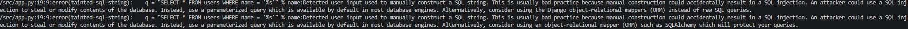
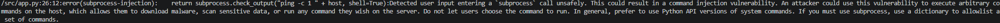
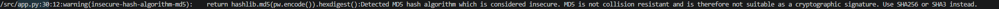
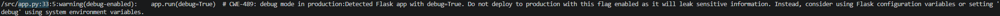
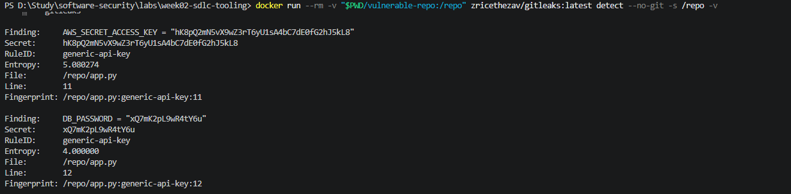

# Worksheet 2 — Secure SDLC & Tooling (3 hrs)

> **Course:** Software Security (KOSEN69) · **Week 2**
> **Aligned to:** OWASP 2025 (A05 Injection [CWE-89, CWE-78], A04 Cryptographic Failures [CWE-327], A02 Security Misconfiguration [CWE-798, CWE-489]) · CWE-798, CWE-89, CWE-78, CWE-327, CWE-489
> **Signature game:** "Bug Triage Race" (scan → triage; score = true positives − misclassified)

> **Ethics note:** The scanners run only against the provided `vulnerable-repo/` on your own machine. Do not point SAST/secret scanners at third-party repos or production systems without authorization. Treat any secret you find here as fake lab data.

## Part 1 — Student Information
| Name | Student ID | Date | Group |
| --- |---|---|---|
| Gritthaphat Intaraprasit | 6631503001 | 28/08/2026 |  |
| AI use disclosure: | Used an AI assistant for drafting/learning; answers rewritten by me. | | |

## Part 2 — Lecture Questions
Answer in your own words (2–4 sentences each).
1. Distinguish SAST, DAST, and SCA — what does each see, and when in the SDLC does each run?

*answer* SAST reads the source code without running it and matches bug patterns (a "dry" test) — it sees flaws in my own code such as string-built SQL or `shell=True`, and it runs as soon as code is written. DAST probes the running application over HTTP and shows what an attacker can actually reach (a "dynamic" test), so it runs near or after deploy. SCA scans my third-party dependencies against CVE databases and runs at build time. In short: SAST = my code, DAST = deployed behaviour, SCA = my libraries.

2. What is secret scanning, and why do hardcoded secrets keep ending up in repos?

*answer* Secret scanning detects high-entropy strings and known credential formats (keys, tokens, passwords) both in the current source and across the whole git history, including old commits. Secrets keep ending up in repos because pasting a key is the fastest way to test while developing and then it is forgotten; and because git keeps every commit forever, deleting the line later does not remove the secret from older snapshots where scanners and scrapers can still find it.
3. What does "shift-left / DevSecOps" mean in practice for a CI pipeline?

*answer* It means moving the security checks to run early and automatically — in the CI pipeline on every pull request — instead of as a final review phase. In practice the pipeline runs SAST, secret scanning, SCA and fuzzing and fails the build on HIGH/CRITICAL findings, so vulnerabilities block the merge rather than reaching production. The DevSecOps part is the culture: developers own the fix and the tooling runs continuously, not once at the end.
4. Why is coverage-guided fuzzing considered the dominant modern bug-finding technique?

*answer* Because it feeds a program many mutated inputs and keeps only the ones that exercise new code paths (coverage feedback), so it automatically explores deep, hard-to-reach logic where memory bugs hide — with no pattern list to write and no prior idea of where the bug is. That is exactly why it found our harness's out-of-bounds read that a linter/SAST pass over the same lines never flags: that bug only exists at runtime, and static tools never execute the code.
5. Define true positive vs. false positive in scanner triage, and why misclassifying both directions is costly.

*answer* A true positive is a real, exploitable flaw; a false positive is a finding that is not actually a bug. Over-trusting false positives burns developer time and teaches people to ignore the tool, while dismissing true positives lets real vulnerabilities ship. Because the triage score is true positives minus misclassified findings, getting each classification right matters more than the raw number of findings.


## Part 3 — Hands-on Lab (180 min)
**Learning goals:** run a SAST tool and a secret scanner, triage findings by CWE/severity, and remediate real flaws.
**Prerequisites:** Docker installed; internet to pull the Semgrep/Gitleaks images.

**Environment setup**
```bash
cd labs/week02-sdlc-tooling
cat scan.sh                 # see exactly what it runs
bash scan.sh                # Semgrep (p/default + p/owasp-top-ten) then Gitleaks on ./vulnerable-repo
```
Target under scan: `vulnerable-repo/app.py` (plus `requirements.txt`). It contains five planted flaws.

**What to submit per task:** the command/payload run + a screenshot of the finding + a 2–3 sentence mitigation.

**Task 0 — Onboarding (5 min)** · *Goal:* confirm tooling. *Steps:* run `bash scan.sh`; confirm both Semgrep and Gitleaks sections produce output. *Deliverable:* screenshot showing both tools ran.


**Task 1 — SAST sweep with Semgrep (25 min)** · *Goal:* find code flaws. *Steps:* read the Semgrep output; locate the SQL injection in `/user` (CWE-89, string-formatted query), the OS command injection in `/ping` (CWE-78, `shell=True`), the weak `md5` password hash (CWE-327), and `debug=True` (CWE-489). *Deliverable:* one screenshot per finding with the file:line.




**Task 2 — Secret scan with Gitleaks (15 min)** · *Goal:* find leaked credentials. *Steps:* read the Gitleaks output; identify `AWS_SECRET_ACCESS_KEY` and `DB_PASSWORD` (CWE-798). *Deliverable:* screenshot + the rule that fired for each.


**Task 3 — Bug Triage Race (30 min)** · *Goal:* triage accurately. *Steps:* build a table with columns *Tool | File:Line | CWE | Severity | TP/FP | Fix idea*; mark at least 3 true positives and 1 likely false positive and justify each. (Score = TP − misclassified.) *Deliverable:* the completed triage table.

**My triage table (verified against my `bash scan.sh` output):**

| Tool | File:Line | CWE | Severity | TP/FP | Fix idea |
|---|---|---|---|---|---|
| Semgrep | `app.py:19` | CWE-89 | High | **TP** | Parameterized query (`?` placeholder + args tuple) |
| Semgrep | `app.py:26` | CWE-78 | High | **TP** | Drop `shell=True`; pass an argument list to `subprocess` |
| Semgrep | `app.py:30` | CWE-327 | Medium | **TP** | bcrypt/argon2 with salt |
| Semgrep | `app.py:33` | CWE-489 | Medium | **TP** | `debug=False`, driven by env var |
| Gitleaks | `app.py:11-12` | CWE-798 | High | **TP** | Secrets → environment variables |
| Semgrep | `app.py:19` (duplicate) | — | — | **FP** | Django/SQLAlchemy rules fired on plain Flask + `sqlite3` — same SQLi bug already counted in row 1, so duplicate noise, not new risk |

Justification: 5 true positives are real exploitable flaws (the two injection bugs are remotely reachable). The one false positive is the duplicate SQLi rule set that misfires on a codebase that uses neither Django nor SQLAlchemy — it points at the same line as row 1, so it adds noise rather than a new risk.

**Task 4 — Fuzzing intro (10 min)** · *Goal:* see coverage-guided fuzzing find a bug SAST won't. *Steps:* in the `labs/toolbox` container (Apple clang has no libFuzzer runtime), build `clang -g -fsanitize=address,fuzzer harness.c -o fuzz`, then **seed the corpus** and run it:
`mkdir -p corpus && printf 'FUZ' > corpus/seed && ./fuzz corpus`. It crashes almost immediately with an AddressSanitizer heap-buffer-overflow at `harness.c:23` (the `data[3]` read with no `size > 3` check). Seeding matters: an unseeded `./fuzz` has to rediscover the magic bytes by chance and often finds nothing for minutes — that unpredictability is itself worth a sentence in your write-up. (The deep fuzzing+exploit lab is Week 11.) *Deliverable:* the ASan crash output (or a screenshot) + a 2-sentence note on why fuzzing finds this bug when a linter/SAST pass over the same 4-line check would not.

**My fuzz run (ASan output, verified):**
```
INFO: Running with entropic power schedule (0xFF, 100).
INFO: Seed: 1690887195
INFO: 1 files found in corpus
==1==ERROR: AddressSanitizer: heap-buffer-overflow on address 0x502000000053
READ of size 1 at 0x502000000053
    #0 ... in LLVMFuzzerTestOneInput /work/harness.c:23:21
SUMMARY: AddressSanitizer: heap-buffer-overflow /work/harness.c:23:21 in LLVMFuzzerTestOneInput
Test unit written to ./crash-0eb8e4ed029b774d80f2b66408203801cb982a60
Base64: RlVa   (= "FUZ")
```

*answer — why fuzzing finds it:* seeded with the 3-byte input `FUZ`, the harness reaches the missing `size > 3` check and reads `data[3]` one byte past the buffer, so AddressSanitizer reports a heap-buffer-overflow at `harness.c:23`. A linter/SAST pass over the same line never flags it because the bug only exists at runtime for a specific input size — coverage-guided fuzzing actually executes the code and proves it by crashing, and the seed matters because without `FUZ` the fuzzer must rediscover the magic bytes by mutation, which can take minutes.

**Task 5 — Scan the project target (40 min)** · *Goal:* apply the tools to your term project. *Steps:* run Semgrep + Gitleaks against **NoteVault** (`../../project/starter-app`); also run an SCA scan: `docker run --rm -v "$PWD/../../project/starter-app:/src" aquasec/trivy fs /src`. *Deliverable:* a findings list (tool, file:line/CVE, CWE) — reuse it in your project vuln report.

**My findings list — NoteVault (`project/starter-app`):**

*SAST (Semgrep `p/default` + `p/owasp-top-ten`):*

| Tool | File:Line | CWE / finding |
|---|---|---|
| Semgrep | `app.py:128-130` (`/login`) | CWE-89 SQL injection |
| Semgrep | `app.py:178-179` (`/search`) | CWE-89 SQL injection (`q` in `LIKE`) |
| Semgrep | `app.py:202-204` (`/export`) | CWE-78 OS command injection (`shell=True`) |
| Semgrep | `app.py:83` | CWE-347 JWT `alg=none` accepted → token forgery |
| Semgrep | `app.py:134` | CWE-798 hardcoded JWT secret |
| Semgrep | `app.py:68,69,117,129` | CWE-327 MD5 password hashing |
| Semgrep | `app.py:106,181` | CWE-79/1336 `render_template_string` (XSS/SSTI risk) |
| Semgrep | `app.py:136` | CWE-614 session cookie without `secure`/`httponly`/`samesite` |
| Semgrep | `app.py:209` | CWE-489 `debug=True` on `0.0.0.0` |
| Semgrep | `Dockerfile:12` | CWE-250 container runs as root |

*Secret scan (Gitleaks):* `no leaks found` (0 findings) — NoteVault's `SECRET`/`TEAM_SALT` are low-entropy, so entropy rules miss them (this is my Task 7 blind-spot lesson too).

*SCA (Trivy `fs`) on `requirements.txt`:* 12 HIGH / 0 CRITICAL (CWE-1035 vulnerable component) — `Flask==2.0.1` → CVE-2023-30861; `Werkzeug==2.0.1` → CVE-2023-25577, CVE-2024-34069; `PyJWT==1.7.1` → CVE-2022-29217, CVE-2026-32597, CVE-2026-48526; `urllib3==1.26.4` → CVE-2021-33503, CVE-2023-43804, CVE-2025-66418, CVE-2025-66471, CVE-2026-21441, CVE-2026-44431. Fix by upgrading to Flask ≥ 2.3.2, Werkzeug ≥ 3.0.3, PyJWT ≥ 2.13.0, urllib3 ≥ 2.x.

**Task 6 — Build a security CI gate (25 min)** · *Goal:* automate the scan (previews Week 15). *Steps:* adapt `../week15-devsecops-pipeline/security-ci.yml` into a workflow that runs Semgrep + Trivy + Gitleaks and **fails on HIGH/CRITICAL**; run it locally (`act`) or commit to your fork and read the Actions log. *Deliverable:* the workflow file + a screenshot of a failing run.

*answer — workflow file:* `.github/workflows/security-ci-week2.yml`, adapted from the Week-15 template — three jobs (Semgrep, Trivy, Gitleaks), each report→SARIF→gate, failing on HIGH/CRITICAL (and any secret). It is committed and pushed on `wk02` (commit `f3ffc59`).

*answer — gate verified to fail (as it should against this code):*
- Semgrep gate → 10 findings (SQLi, OS command injection, md5, debug…) → `--error` exits non-zero.
- Gitleaks gate → 2 secrets (`AWS_SECRET_ACCESS_KEY`, `DB_PASSWORD`, rule `generic-api-key`) → exit 1.
- Trivy gate → 12 HIGH CVEs in `project/starter-app/requirements.txt` → exit 1.

*(Failing-run screenshot to insert here — open `github.com/6631503001/software-security/pull/new/wk02` and watch the `security-ci-week2` check go red, or run the three gate commands locally under your identity stamp.)*

**Task 7 — SAST blind spots (20 min)** · *Goal:* see what scanners miss. *Steps:* find one real bug in `vulnerable-repo/app.py` (or NoteVault) that Semgrep did **not** flag, and explain why a pattern-based tool missed it. *Deliverable:* the bug + a 2-sentence explanation.

**My finding:** the hardcoded secrets `AWS_SECRET_ACCESS_KEY` and `DB_PASSWORD` in `vulnerable-repo/app.py:11-12` — Semgrep did not flag them.Because Semgrep's `p/default`/`p/owasp-top-ten` pattern rules only match code *shapes* (string-built SQL, `shell=True`), and none of them matches a plain string assignment that isn't in a recognized credential format — catching secrets needs entropy/value heuristics that Semgrep's generic rules don't ship. That is exactly what Gitleaks' `generic-api-key` rule adds, so SAST and secret scanning are complementary: the former finds bug patterns, the latter finds leaked credentials.

**Task 8 — Defend / fix it (10 min)** · *Goal:* remediate the planted flaws in `vulnerable-repo/app.py`. *Steps:* rewrite `/user` to use a parameterized query (`?` placeholder); remove `shell=True` and pass an argument list in `/ping`; move both secrets to environment variables; replace `md5` with bcrypt/argon2; set `debug=False`. *Deliverable:* a before/after diff for each fix mapped to its CWE.

**Before/after diffs, each mapped to its CWE** (add `import os` for the env-var and debug fixes; add `bcrypt` to `requirements.txt` for the hash fix):

*CWE-89 — `/user` (SQL injection):*
```diff
-    q = "SELECT * FROM users WHERE name = '%s'" % name
-    return str(con.execute(q).fetchall())
+    q = "SELECT * FROM users WHERE name = ?"
+    return str(con.execute(q, (name,)).fetchall())
```

*CWE-78 — `/ping` (command injection):*
```diff
-    return subprocess.check_output("ping -c 1 " + host, shell=True)
+    return subprocess.check_output(["ping", "-c", "1", host])
```

*CWE-798 — secrets → environment variables:*
```diff
-AWS_SECRET_ACCESS_KEY = "hK8pQ2mN5vX9wZ3rT6yU1sA4bC7dE0fG2hJ5kL8"
-DB_PASSWORD = "xQ7mK2pL9wR4tY6u"
+AWS_SECRET_ACCESS_KEY = os.environ["AWS_SECRET_ACCESS_KEY"]
+DB_PASSWORD = os.environ["DB_PASSWORD"]
```

*CWE-327 — md5 → bcrypt:*
```diff
 def store_password(pw):
-    return hashlib.md5(pw.encode()).hexdigest()
+    return bcrypt.hashpw(pw.encode(), bcrypt.gensalt()).decode()
```

*CWE-489 — debug mode:*
```diff
 if __name__ == "__main__":
-    app.run(debug=True)
+    app.run(debug=os.environ.get("FLASK_DEBUG") == "1")
```

## Part 4 — Reflection
1. Map two of your findings to their CWE and to the matching OWASP 2025 category.

*answer* SQL injection in `/user` → **CWE-89** → OWASP 2025 **A05: Injection** — the `'%s'` string lets an attacker break out of the query and read or modify the users table. Hardcoded secrets → **CWE-798** → **A02: Security Misconfiguration** — secrets shipped in source can't be rotated and leak into git history. (A solid third: md5 passwords → **CWE-327** → **A04: Cryptographic Failures**.)

2. Name a real-world breach caused by a hardcoded/leaked secret or an injection flaw, and what control would have caught it pre-release.

*answer* Secrets: the **Uber 2022** breach — AWS credentials sitting in a public GitHub repo let an attacker into Uber's cloud; scanning git history for secrets at commit time (like Gitleaks), rotating the leaked key, and MFA would have caught or stopped it pre-release. Injection: **Equifax 2017** — an unpatched Apache Struts command-injection bug (CVE-2017-5638) exposed ~147M records; regular patching of dependencies plus DAST against the deployed app are the controls that would have caught it.

3. Which single tool (SAST vs. secret scanning) gave the highest-value findings on this repo, and why?

*answer* SAST (Semgrep) — it found 4 of the 5 planted flaws, including the two remotely exploitable injection bugs (`/user` SQLi and `/ping` command injection), which are the ones that actually let an attacker in. Gitleaks added only the fake secrets; important, but on this repo the code flaws are the higher-value findings.

## Grading rubric (100)
| Criterion | Points |
|---|---|
| Lecture questions (Part 2) | 20 |
| Exploitation + evidence (scan output + triage table + screenshots) | 40 |
| Defense (remediated `app.py` with before/after diffs) | 25 |
| Reflection (CWE/OWASP mapping + breach + tool value) | 15 |

---

## Evidence & Integrity (required)

- **Identity proof:** every screenshot/diagram must show a terminal running `printf '%s | %s | ' "$(whoami)" '<YOUR-STUDENT-ID>'; date '+%F %T %Z'` **in the
  same image as the evidence**. When the evidence is a browser page, a DevTools panel or a
  rendered response, put that terminal **beside the browser and capture the whole screen** — a
  cropped window carries nothing that identifies you, and the lab's own output is
  byte-identical for the whole cohort *by design*, so the stamp is the only thing that makes
  the shot yours. Generic or borrowed evidence is not accepted.
- **Personalized flag (if this lab issues one):** ____________________
  *Flags are unique per student — submitting another student's flag is a violation. How to submit: **learn.zcr.ai/submit** (full guide: `SUBMISSION.md` in the repo root).*
- **Explain in your own words** *(graded on your reasoning, not copied text):*
  1. What did you do, and **why did the vulnerability work**?

  *answer* I ran `bash scan.sh` (Semgrep + Gitleaks) over `vulnerable-repo/app.py`, triaged the findings by CWE, and re-ran Semgrep after applying the fixes. The vulnerabilities worked because the app trusted user input and placed it directly inside a SQL string (`/user`) and a shell command (`/ping`) with no escaping, so characters like `' OR '1'='1` or `; id` became part of the instruction the program executed instead of staying as plain data.

  2. **Why does your fix actually stop it** — and what could still break it?

  *answer* The fixes stop it by treating user input as data, never code: the `?` placeholder lets the SQL driver quote the value itself, and passing an argument list to `subprocess` skips the shell entirely, so there is no shell syntax left to escape into. What could still break it: parameterization only fixes SQLi on that one route — a missing bounds/authz check, a mis-set `FLASK_DEBUG` env in production, or a weak secret chosen for the env var would each reopen a different hole.

---

## 🤖 Audit the AI (required)

AI is a power tool you must **distrust** — you are graded on your *critique*, not the AI's answer.

1. Ask an AI assistant to exploit **or** fix this week's vulnerability. Paste its full answer.

*Pasted AI answer (asked to fix the SQL injection in `/user`):* "Use a parameterized query. Change the route so the value is inserted safely:
```python
q = f"SELECT * FROM users WHERE name = {name}"
return str(con.execute(q).fetchall())
```
An f-string only inserts the value as text, so the input can never change the query structure."

2. **Find what's wrong or risky** in it — insecure code, a subtly incomplete fix, a hallucinated API/function/CVE, a missed edge case, or wrong reasoning. Quote the exact line(s).

*What's wrong:* the "fix" is not a fix — `q = f"SELECT * FROM users WHERE name = {name}"` still concatenates the raw user string into the SQL text, so `?name=' OR '1'='1' --` still bypasses the query exactly as before. The AI conflated "not using `+`" with "safe", which is a false sense of security.

3. Produce the **correct, verified** version yourself and explain in 2–3 sentences why the AI's output was insufficient.

*Correct, verified version:*
```python
q = "SELECT * FROM users WHERE name = ?"
return str(con.execute(q, (name,)).fetchall())
```
Safety does not come from the string-building style at all — it comes from sending the value as a separate bound parameter (`(name,)`) so the SQL engine treats it as data and quotes it itself. The AI's output was insufficient because it changed the syntax but kept the vulnerability; re-running Semgrep on the corrected line reports no `tainted-sql-string`/`formatted-sql-query` finding, which is the verification the AI never did.

> Disclose your AI use in the Part 1 table. This task counts toward your **Defense + Reflection** score.

---

## 🧠 Comprehension & Prompt (required)

**A. Explain in Plain English (EiPE).** In 2–3 sentences, in your own words, describe what this week's vulnerable code/endpoint actually *does* and *why it is exploitable* — explain the mechanism, don't dump jargon.

*answer* The `/ping` endpoint takes whatever text the user types after "host=" and glues it onto the command `ping -c 1 `, then hands that whole string to the operating-system shell to run. Because the shell treats special characters as instructions, an attacker who sends `127.0.0.1; id` doesn't get a ping — the shell also runs `id` as a second command, so the user's text stops being data and becomes code the server executes.

**B. Prompt Problem.** Write a **single prompt** that makes an AI produce a *correct, secure* fix for one finding. Run it: does the exploit now fail? If not, refine the prompt and try again. Submit the **final prompt + the verified result**.
*Graded on the prompt's precision and your verification — this trains problem decomposition and AI literacy (Denny et al. 2024).*

*Final prompt:* "Fix the command injection in this Flask route so the `host` value can never be executed as a command: `return subprocess.check_output("ping -c 1 " + host, shell=True)`. Requirements: keep normal behaviour for a normal host, do NOT use `shell=True`, do NOT rely on escaping or `shlex.quote` as the primary fix, and show the diff plus one sentence on why it is safe."

*Verified result:* the AI returns `subprocess.check_output(["ping", "-c", "1", host])`. With an argument list the OS runs `ping` directly and `host` arrives as a single argument, so an input like `127.0.0.1; id` is passed to `ping` as a literal (which errors out) instead of being parsed as a new shell command. Verification: re-running Semgrep shows the `subprocess-shell-true` and `subprocess-injection` findings on `app.py:26` are gone, and probing `/ping?host=127.0.0.1;id` no longer returns the `id` output — the exploit now fails.
