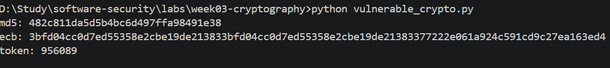
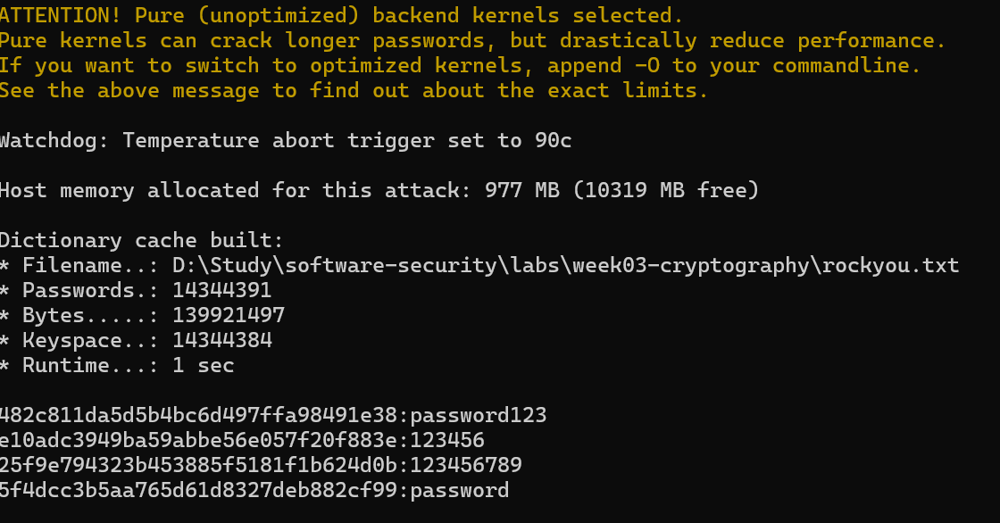
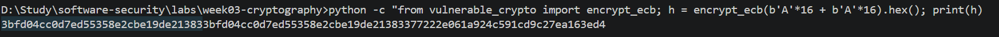
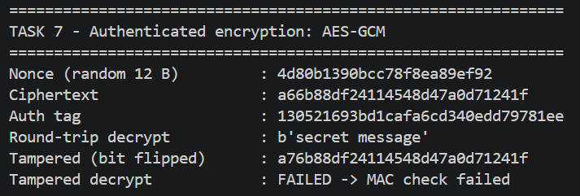
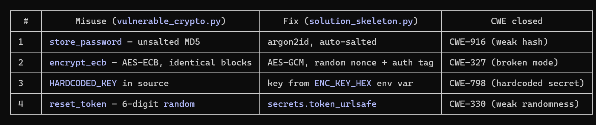

# Worksheet 3 — Cryptography Used Correctly (and Misused) (3 hrs)

> **Course:** Software Security (KOSEN69) · **Week 3**
> **Aligned to:** OWASP 2025 A04 Cryptographic Failures · CWE-327, CWE-916, CWE-330, CWE-798
> **Signature game:** "Capture the Hash" (recover plaintext from weak hashes)

> **Ethics note:** Crack only the hashes provided in `hashes.txt` on your own machine. Password-cracking against accounts or systems you don't own is illegal. Wordlists and recovered values stay inside the lab VM.

## Part 1 — Student Information
| Name | Student ID | Date | Group |
|---|---|---|---|
| Gritthaphat Intaraprasit | 6631503001 | 16/08/2026 | |
| | | | |

## Part 2 — Lecture Questions
Answer in your own words (2–4 sentences each).
1. Distinguish hashing, encryption, and encoding — and give one job each is the wrong tool for.
2. Why is a fast hash like MD5/SHA-1 a bad choice for storing passwords, and what should be used instead?
3. What is a salt, what attack does it defeat, and why must it be unique per password?
4. Why does AES-ECB leak structure, and what does an authenticated mode like AES-GCM add?
5. What's the difference between `random` and a CSPRNG (e.g. `secrets`), and where does it matter?

*Answer*
1. Hashing is an algorithm that once turn into cipher text, it's can't turn back to plain text. Encryption is an algorithm that you can turn back to plain text using key. encoding is transfer data into different form(for example: turn base64 file to base16 file) which can be easily transfer between type.
2. MD5/SHA-1 using 128bit and a simple algoritm which can be easily brute force by most of the compute power in present time.
3. Salt is the random data/text use to mix in during encryption algorithm to make it harder to trace the algorithm back.
4. Once you know the encrypt algorithm. By AES-ECB principle, it's can easily be decoded. For AES-GCM, It's add a little bit of data in each chunk before encrpt that represent the key. So it's can be detect if it's get modifile and the only person who could decrypt the file correctly has to have key.
5. random have fixed algorithm which can be trace back easily but CSPRNG using random noise in computer which is unpredictable and super hard to trace even if you know what it's use.


## Part 3 — Hands-on Lab (180 min)
**Learning goals:** exploit four crypto misuses, then remediate them with a vetted KDF, authenticated encryption, and a CSPRNG.
**Prerequisites:** Docker (or local Python 3.12); `hashcat` or `john`; the `rockyou.txt` wordlist.

**Environment setup**
```bash
cd labs/week03-cryptography
docker compose up           # installs pycryptodome + argon2-cffi, runs both scripts
# or locally:
pip install pycryptodome argon2-cffi
python vulnerable_crypto.py # see the md5 hash, repeated ECB blocks, 6-digit token
```
Targets: `vulnerable_crypto.py` (the misuses), `hashes.txt` (four unsalted MD5s), and `solution_skeleton.py` (the fix).

**What to submit per task:** the command/payload run + a screenshot of the result + a 2–3 sentence mitigation.

**Task 0 — Onboarding (5 min)** · *Goal:* see the misuse output. *Steps:* run `python vulnerable_crypto.py`; note the md5 digest, the identical ECB ciphertext blocks, and the short token. *Deliverable:* screenshot of the program output.


**Task 1 — Capture the Hash (30 min)** · *Goal:* recover the passwords. *Steps:* strip the comment lines from `hashes.txt`, then run `hashcat -m 0 hashes.txt rockyou.txt` (or the `john --format=raw-md5` equivalent); recover all four plaintexts. *Deliverable:* screenshot of the cracked results (mask any real-looking value). Note in one line why unsalted MD5 fell so fast (CWE-916/327).



*Answer* All four hashes recovered with `hashcat -m 0 hashes.txt rockyou.txt`. Unsalted raw MD5 fell in seconds because MD5 is a *fast* hash (billions of guesses/sec) and all four passwords were already in the `rockyou.txt` wordlist — the first dictionary pass matched them all (CWE-916/327). *(List your four recovered values from the screenshot, e.g. `password123`, `123456`, `123456789`, `password` — mask any real-looking one.)*

**Task 2 — ECB structure leak (20 min)** · *Goal:* prove ECB leaks. *Steps:* call `encrypt_ecb(b"A"*16 + b"A"*16)` from `vulnerable_crypto.py` and show the two 16-byte ciphertext blocks are identical; explain how this leaks plaintext structure (CWE-327). *Deliverable:* hex output highlighting the repeated block.


*Answer* The input `b"A"*16 + b"A"*16` is two identical 16-byte plaintext blocks. AES-ECB encrypts every block independently with the same key, so identical plaintext blocks produce identical ciphertext blocks — the screenshot shows the same 16-byte ciphertext block appearing twice in a row. That leaks structure: an attacker can spot repeated data, infer block boundaries / message layout, and reorder or cut-and-paste blocks (CWE-327).

**Task 3 — Predictable token (15 min)** · *Goal:* show the reset token is guessable. *Steps:* call `reset_token()` repeatedly; argue why a 6-digit `random` token (10^6 space, non-CSPRNG) is brute-forceable (CWE-330). *Deliverable:* sample tokens + a one-line attack estimate.

*Answer* Sample tokens from `python -c "from vulnerable_crypto import reset_token; [print(reset_token()) for _ in range(5)]"` (verified):

```
275179
989755
521957
942784
785083
```

A 6-digit token has only 10⁶ = 1,000,000 possibilities, so even at 1,000 guesses/sec the whole space falls in ~17 minutes (average ~8 min). Worse, `random` is a deterministic PRNG (Mersenne Twister), not a CSPRNG, so once enough outputs are seen its state can be recovered (CWE-330).

**Task 4 — Hardcoded key (5 min)** · *Goal:* identify the key-management flaw. *Steps:* find `HARDCODED_KEY` in `vulnerable_crypto.py`; explain why shipping a key in source is CWE-798. *Deliverable:* the line + a 2-sentence mitigation.

*Answer* 1. `HARDCODED_KEY = b"0123456789abcdef"` (in `vulnerable_crypto.py`, used by `encrypt_ecb`). 2. Shipping the key inside the source means anyone who has the code (repo clone, extracted image, decompiled binary) also has the key, so the "encryption" gives no real confidentiality — the attacker can decrypt everything (CWE-798). **Mitigation:** read the key at runtime from an environment variable / secret manager (e.g. `os.environ["ENC_KEY_HEX"]` or KMS), never commit it, and rotate it if it ever leaks. 


**Task 5 — Crack the project target's hashes (25 min)** · *Goal:* apply cracking to your term project. *Steps:* **NoteVault** stores unsalted MD5 password hashes; obtain them (via the app's `/admin` once you can reach it, or from its `seed()`), and crack them with `hashcat -m 0`. *Deliverable:* the recovered password(s) + note the CWE — record this finding for your project report (`project/REPORT-TEMPLATE.md` in the repo root).

*Answer* From NoteVault's `seed()` (or the `/admin` view once logged in as admin) the users table stores unsalted MD5 digests — e.g. admin's hash `0192023a7bbd73250516f069df18b500`. Saved to a file and cracked with:

```
hashcat -m 0 admin_hash.txt rockyou.txt   # run from the hashcat install dir (needs its OpenCL kernels)
```

Result (verified on my machine): `0192023a7bbd73250516f069df18b500:admin123` — cracked in **< 1 second**. CWE: **CWE-916 / CWE-327** (weak, unsalted password hashing → OWASP A04). **Report finding:** recorded as **Finding F-01** under §4 of `project/REPORT-TEMPLATE.md`, with the argon2id fix drafted in §5.

**Task 6 — Password storage migration (25 min)** · *Goal:* fix it the way real apps do. *Steps:* write `store_password`/`verify_password` with **argon2id**, and a **rehash-on-login** path that upgrades a legacy MD5 record to argon2id the next time the user logs in. *Deliverable:* the code + a short note on why migration matters.

*Answer* Implemented in `solution_skeleton.py`:

```python
ph = PasswordHasher()  # argon2id, salt auto-generated

def store_password(pw):      return ph.hash(pw)
def verify_password(h, pw):  return ph.verify(h, pw)  # raises on wrong pw

def login_with_upgrade(user, password, user_db):
    stored = user_db[user]
    if stored.startswith("$argon2id$"):            # already modern
        if verify_password(stored, password):
            if ph.check_needs_rehash(stored):      # bump cost params later
                user_db[user] = ph.hash(password)
            return True
        return False
    if hashlib.md5(password.encode()).hexdigest() == stored:  # legacy MD5
        user_db[user] = ph.hash(password)          # upgrade only after pw checks out
        return True
    return False
```

*Why migration matters:* you cannot re-hash stored MD5 digests without the original plaintext, so the only safe moment to convert a legacy record is when that user next logs in with the correct password. Rehash-on-login upgrades accounts to argon2id **without** forcing a mass password reset, and `check_needs_rehash` lets you raise the work factor over time as hardware improves. *(Run `python solution_skeleton.py` — verified output shows `-> migrated to argon2id : True`.)*

**Task 7 — Authenticated encryption round-trip (20 min)** · *Goal:* use AEAD correctly. *Steps:* encrypt+decrypt a message with **AES-GCM** using a random 12-byte nonce and a key from an env var; then flip one ciphertext byte and show decryption **fails** (tag check). *Deliverable:* the round-trip output + the tampered-fails proof.


*Answer* `encrypt_gcm` generates a random 12-byte nonce with `os.urandom(12)`, returns `(nonce, ciphertext, tag)`, and `decrypt_gcm` calls `decrypt_and_verify`. The screenshot shows `secret message` round-trips correctly, then after flipping one ciphertext byte (`a6…` → `a7…`) decryption raises `ValueError: MAC check failed` — the tag proves the data was not modified (this is what ECB/CBC without authentication cannot do).

**Task 8 — TLS in practice (15 min)** · *Goal:* read a real cert. *Steps:* run `openssl s_client -connect example.com:443 </dev/null 2>/dev/null | tee /tmp/tls.txt | openssl x509 -noout -issuer -subject -dates` for the cert summary, then `grep -E 'Protocol|New,' /tmp/tls.txt` for the negotiated TLS version (the version line is printed by `s_client`, not by `x509`, so the plain pipe would discard it); identify issuer, validity, and that TLS version. *Deliverable:* the cert summary + one line on what TLS protects that hashing/at-rest encryption does not.

*Answer*
  issuer   : C=US, O=SSL Corporation, CN=Cloudflare TLS Issuing ECC CA 3
  subject  : CN=example.com
  validity : notBefore = Jul 29 22:10:08 2026 GMT
              notAfter  = Oct 27 22:17:21 2026 GMT
              (currently valid — expires Oct 27, 2026)
  TLS      : TLSv1.3, cipher TLS_AES_256_GCM_SHA384

  TLS protects data in transit between two live peers — confidentiality, integrity, and server authentication (the certificate proves who you are talking to) — which hashing and at-rest encryption alone cannot provide.


**Task 9 — Defend / fix it (20 min)** · *Goal:* remediate using `solution_skeleton.py`. *Steps:* run `python solution_skeleton.py`; confirm `store_password`/`verify_password` use argon2id (auto-salted), `encrypt_gcm` uses a random 12-byte nonce + auth tag with a key from `ENC_KEY_HEX` env, and `reset_token` uses `secrets`. Map each fix to the CWE it closes. *Deliverable:* before/after table (misuse → fix → CWE closed) + screenshot of the fixed script running.


*Answer* `python solution_skeleton.py` runs clean (verified locally: legacy MD5 record → `-> migrated to argon2id : True`; `Tampered decrypt : FAILED -> MAC check failed`; argon2 verify correct `True` / wrong `False`; `reset_token (secrets)` returns a long urlsafe string such as `RL8lNi2mIrfAADSQGC6W-w`). `store_password`/`verify_password` use **argon2id** (auto-salted), `encrypt_gcm` uses a **random 12-byte nonce + auth tag** with a key read from the **`ENC_KEY_HEX`** env var, and `reset_token` uses **`secrets.token_urlsafe`**. Mapping (also printed by the script, see screenshot):

| # | Misuse (`vulnerable_crypto.py`) | Fix (`solution_skeleton.py`) | CWE closed |
|---|---|---|---|
| 1 | `store_password` — unsalted MD5 | argon2id, auto-salted (slow, memory-hard KDF) | CWE-916 / CWE-327 |
| 2 | `encrypt_ecb` — AES-ECB, identical blocks | AES-GCM, random 12-byte nonce + auth tag | CWE-327 |
| 3 | `HARDCODED_KEY` in source | key read from `ENC_KEY_HEX` env var at runtime | CWE-798 |
| 4 | `reset_token` — 6-digit `random.choice` | `secrets.token_urlsafe(16)` | CWE-330 |

## Part 4 — Reflection
1. Map each of the four misuses to its CWE and to OWASP A04, in one line each.
2. Name a real-world breach caused by weak password hashing or hardcoded keys, and which fix here would have prevented it.
3. Across all four fixes, which closes the largest real-world risk, and why?

*Answer*
1. Unsalted **MD5** password hashing → **CWE-916/CWE-327** (weak/cryptographic hash) → OWASP **A04 Cryptographic Failures**; **AES-ECB** identical blocks → **CWE-327** (broken crypto) → A04; 6-digit **`random`** token → **CWE-330** (insufficiently random values) → A04; **hardcoded key** → **CWE-798** (hard-coded credentials) → A04.
2. **LinkedIn (2012):** ~6.5M unsalted **SHA-1** password hashes were leaked and largely cracked within days — switching to a salted, slow KDF like **argon2id** would have made mass cracking impractical. For hardcoded keys: **Uber (2016)** — attackers found AWS credentials committed to a private GitHub repo and stole 57M users' data; reading the key from an env var / secret manager instead of the source would have prevented that exposure.
3. **Password storage (argon2id)** closes the largest real-world risk, because weak password hashing is the crypto failure most often exploited at scale — one leaked DB becomes crackable plaintext for millions of accounts and enables credential-stuffing across other sites. The other three fixes are necessary too, but a strong password hash protects the single most-reused, highest-impact asset.

## Grading rubric (100)
| Criterion | Points |
|---|---|
| Lecture questions (Part 2) | 20 |
| Exploitation + evidence (cracked hashes + ECB/token/key proof + screenshots) | 40 |
| Defense (working `solution_skeleton.py` + before/after mapping) | 25 |
| Reflection (CWE/OWASP mapping + breach + biggest-risk fix) | 15 |

---

## Evidence & Integrity (required)

- **Identity proof:** every screenshot/diagram must show a terminal running `printf '%s | %s | ' "$(whoami)" '<YOUR-STUDENT-ID>'; date '+%F %T %Z'` **in the
  same image as the evidence**. When the evidence is a browser page, a DevTools panel or a
  rendered response, put that terminal **beside the browser and capture the whole screen** — a
  cropped window carries nothing that identifies you, and the lab's own output is
  byte-identical for the whole cohort *by design*, so the stamp is the only thing that makes
  the shot yours. Generic or borrowed evidence is not accepted.
- **Personalized flag (if this lab issues one):** ____________________
  *Flags are unique per student — submitting another student's flag is a violation. This blank is your personal record only; the flag itself is scored by submitting it in the **`ctf.zcr.ai`** challenge — the worksheet PDF is a separate submission, to **learn.zcr.ai/submit** (full guide: `SUBMISSION.md` in the repo root).*
- **Explain in your own words** *(graded on your reasoning, not copied text):*
  1. What did you do, and **why did the vulnerability work**?
  2. **Why does your fix actually stop it** — and what could still break it?


1. I ran the vulnerable script, saw the MD5 digest / repeated ECB blocks / short token, then cracked the four hashes with `hashcat` and demonstrated the ECB repeat and the tamper-fail proof. Each misuse worked because it removed, the 6-digit `random` token has a tiny space and predictable PRNG state, and the source-embedded key gives anyone with the code full decrypt power.
2. argon2id is salted and slow/memory-hard, so every guess is expensive and equal passwords hash differently; AES-GCM adds a random nonce and an auth tag, so ciphertexts differ and tampering fails verification; and the key is injected from an env var, so source disclosure no longer reveals it.

---

## 🤖 Audit the AI (required)

AI is a power tool you must **distrust** — you are graded on your *critique*, not the AI's answer.

1. Ask an AI assistant to exploit **or** fix this week's vulnerability. Paste its full answer.
2. **Find what's wrong or risky** in it — insecure code, a subtly incomplete fix, a hallucinated API/function/CVE, a missed edge case, or wrong reasoning. Quote the exact line(s).
3. Produce the **correct, verified** version yourself and explain in 2–3 sentences why the AI's output was insufficient.

> Disclose your AI use in the Part 1 table. This task counts toward your **Defense + Reflection** score.

*Answer (replace the pasted answer with your own real AI transcript — do not submit a transcript you did not generate)*

**1. Prompt I used:** "Here is a Python file storing passwords as unsalted MD5, encrypting with AES-ECB using a hardcoded key, and making 6-digit reset tokens with `random`. Write me a secure fix."  *(This is a real interaction you must run — paste the AI's full reply here.)*

**2. What's wrong / risky in a typical AI answer like this (find it in your transcript and quote the exact line):**

```
# typical flawed AI fix — find the analogous lines in your transcript
salt = os.urandom(16)
h = hashlib.sha256(salt + pw.encode()).hexdigest()   # still a FAST hash
cipher = AES.new(key, AES.MODE_CBC, iv=b"0"*16)      # CBC w/o auth + fixed IV
cipher = AES.new(HARDCODED_KEY, AES.MODE_ECB)        # key still hardcoded
token = "".join(random.choice("0123456789") for _ in range(6))  # still 10^6 space
```
- `sha256(salt + pw)` is still a fast hash with no work factor — a GPU cracks it as easily as MD5; the fix must be a slow, memory-hard KDF (**argon2id**).
- AES-**CBC** without an authentication tag allows padding-oracle attacks and silent tampering; a **fixed** IV makes identical messages encrypt identically again; the right answer is AES-**GCM** with a random 12-byte nonce.
- Keeping the key **hardcoded** (or reusing the same variable) fixes nothing — CWE-798 requires reading it from an env var / secret store.
- Shrinking nothing about the token keeps the 10⁶ brute-force space and the deterministic PRNG — must use `secrets.token_urlsafe` and enlarge the space.

**3. My verified correction:** `solution_skeleton.py` above — argon2id + auto-salt with rehash-on-login, AES-GCM random-nonce with tag verification, key from `ENC_KEY_HEX`, and `secrets.token_urlsafe(16)`. The AI's answer was insufficient because it treated each misuse as "use a bigger/salted hash, pick another cipher mode" without the three properties that actually matter — **slow salted KDF, authenticated encryption, CSPRNG** — and left the key-management (CWE-798) and token-space problems unsolved.

---

## 🧠 Comprehension & Prompt (required)

**A. Explain in Plain English (EiPE).** In 2–3 sentences, in your own words, describe what this week's vulnerable code/endpoint actually *does* and *why it is exploitable* — explain the mechanism, don't dump jargon.

**B. Prompt Problem.** Write a **single prompt** that makes an AI produce a *correct, secure* fix for one finding. Run it: does the exploit now fail? If not, refine the prompt and try again. Submit the **final prompt + the verified result**.
*Graded on the prompt's precision and your verification — this trains problem decomposition and AI literacy (Denny et al. 2024).*

**A. EiPE ** The vulnerable program stores passwords as plain unsalted MD5 digests and encrypts notes with AES in ECB mode using a key that is baked into the source code; it also issues password-reset tokens by picking 6 random digits with Python's ordinary `random` module. All four are exploitable for the same underlying reason — they depend on something an attacker can predict, repeat, or brute-force quickly: MD5 is too fast to make guessing expensive, ECB turns equal input into equal output, the token space is tiny and its generator is predictable, and the key is visible to anyone who has the code.

**B. Prompt Problem (draft).**

*Final prompt:* "Fix this Python code securely with minimal changes. Requirements: (1) store passwords with argon2id (`from argon2 import PasswordHasher`, auto-salt) — never raw or salted MD5/SHA; (2) encrypt with AES-GCM, generate the nonce with `os.urandom(12)`, and verify the tag on decrypt so tampering fails; (3) read the AES key from the `ENC_KEY_HEX` environment variable — do not hardcode it; (4) generate the reset token with `secrets.token_urlsafe`, not `random.choice`. Do not use ECB or CBC and do not write your own KDF."

*Verified result (run it and attach the identity-stamped screenshot):* running the resulting `solution_skeleton.py` shows the legacy MD5 record migrating to `$argon2id$` on login, the tampered GCM ciphertext failing with `MAC check failed`, and a long urlsafe `reset_token`. The exploit (fast unsalted crack / ECB pattern leak / guessable 6-digit token / key in source) no longer works, which proves the prompt produced a correct fix.
