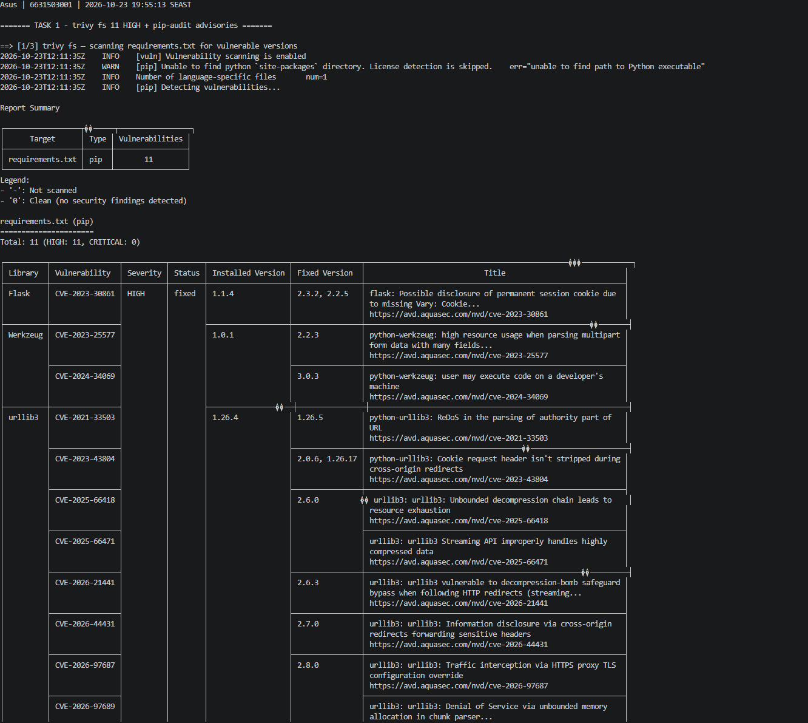
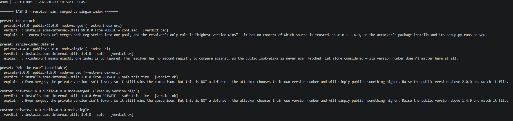
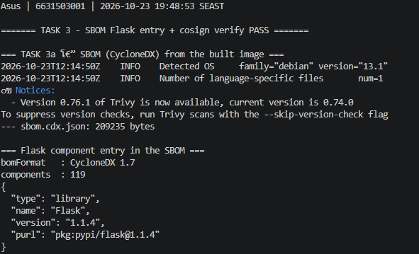
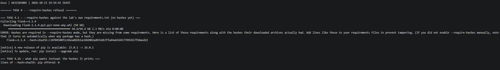

# Worksheet 12 — Software Supply-Chain Security (3 hrs)

> **Course:** Software Security (KOSEN69) · Week 12
> **Aligned:** OWASP 2025 — A03 Software Supply Chain Failures · A08 Software or Data Integrity Failures · **CWE:** CWE-1104, CWE-829, CWE-1357, CWE-1395
> **Signature game:** 📦 Dependency Confusion Heist
>
> **Ethics note:** No package was installed from, or published to, any real index as part of the attack. Task 2 was run as the lab intends: the shipped resolver simulation's own logic, executed offline. `acme-internal-utils` was never published anywhere.

## Part 1 — Student Information

| Name | Student ID | Date | Group |
|------|-----------|------|-------|
| Gritthaphat Intaraprasit | 6631503001 | 23/10/2026 | |

**AI use disclosed:** I used an AI assistant to help drive the scan/sign commands and to draft wording; every CVE/advisory id, digest and verdict below comes from the tool output in Part 3 (raw transcripts in `evidence/`), and the Audit-the-AI section quotes a real answer from it plus my critique. Two environment substitutions are disclosed rather than papered over: (a) `sign.sh`'s **keyless** cosign flow needs an OIDC browser login *and* a registry push, which I did not have, so I pushed to a **local OCI registry** (`localhost:5050`) and signed with a **local key pair** — same sign/verify/negative-test evidence, different trust root; (b) the Task 2 simulation is a browser page, so I executed its actual `resolver-confusion.js` logic headlessly (Node) instead of screenshotting a browser.

## Part 2 — Lecture Questions

**1. Explain dependency confusion (substitution). Why does a public `acme-internal-utils==99.0.0` win over a private `==1.4.0` when a resolver shops both indexes?**

Dependency confusion is name substitution: the attacker publishes a package with the *same name* as an internal dependency on the public index, with a version number high enough to look newest. When a build is configured with `--extra-index-url`, pip merges the configured indexes into one candidate pool and its only rule is "highest version wins" — it has no notion of which index is trusted, so `99.0.0` from the public index beats `1.4.0` from the private one, and the attacker's `setup.py` runs as the build user at install time. The private dependency never had a chance to be "verified"; it lost a version comparison.

**2. How does typosquatting (`reqeusts`, `urlib3`) achieve code execution *at install time* before any of your code runs?**

Because installing a Python package is *executing* it: pip downloads the sdist/wheel and runs `setup.py`/`setup.cfg` hooks (or any imported module during build) in the build environment as your user, before a single line of your application is loaded. A near-miss name only needs to be typed once — by a human or by a model-generated `requirements.txt` — and the attacker's build script has already run with your credentials, your network position and your cache.

**3. What is an SBOM (CycloneDX/SPDX) and why is it a prerequisite for both incident response and SLSA provenance?**

An SBOM is a machine-readable inventory of what is actually inside a build: components, versions, and identifiers such as `purl` (`pkg:pypi/flask@1.1.4`) — my Task 3 SBOM lists 119 components for a 4-line app. It is a prerequisite for incident response because "am I affected?" becomes a query instead of an archaeology project (Log4Shell: grep your SBOM for the component and version, in minutes, across every image you ship), and for SLSA provenance because provenance attests *how* an artifact was built *from which inputs* — you cannot bind a build to its inputs if you cannot name the inputs, and an auditor cannot check that the listed components are the ones in the artifact without an inventory to check against.

**4. Sigstore keyless signing uses Fulcio (CA) + Rekor (transparency log) tied to an OIDC identity. Why is that safer than a long-lived private key (CWE-321)?**

A long-lived private key is a single static secret: it has to be stored somewhere (CI variable, laptop, vault), it is only as strong as that storage, it never rotates, it leaves no public trace when it is abused, and if it leaks the attacker can sign *anything* forever with no way to tell their signatures from yours — the CWE-321 failure mode. Keyless replaces it with an ephemeral key pair whose public half is certified by Fulcio against an OIDC identity (so the certificate says *who* was authenticating, for a validity window of minutes), and Rekor logs every signing event in an append-only transparency log, so use is *visible* and a rogue signature cannot be quietly added. The trust root moves from "a secret nobody leaked" to "an identity provider plus a public audit log", and the private half exists only for seconds.

**5. Summarise the SLSA levels. Which level does "signed artifact + SBOM + provenance gate before deploy" put you at, and what is still missing?**

SLSA Build levels: **L1** = provenance exists and is generated (untrusted, easily forged); **L2** = hosted build platform with signed provenance, so a third party can verify the build ran where it claims with the source it claims; **L3** = hardened, isolated build platform with strong non-falsifiability (builds cannot tamper with each other, credentials are short-lived). "Signed artifact + SBOM + a provenance gate before deploy" is **L2 territory** — you can verify *who* produced the artifact and *what* went into it, and you refuse unsigned artifacts, but the signature only proves the artifact was signed by that identity, not that the build ran on a platform that could not have been subverted. What is missing for L3: an isolated/hosted builder with attested, non-falsifiable provenance, a policy that binds the *expected* source repo + builder identity (not just "some signature"), and enforcement that is not bypassable by a human with deploy rights.

## Part 3 — Hands-on Lab

**Environment**
```bash
cd labs/week12-supply-chain
bash sca_scan.sh                                   # trivy fs + pip-audit (+ image scan if built)
docker build -t week12-supplychain:lab .
docker run -d --name w12reg -p 5050:5000 registry:2   # local OCI registry so a signature has a home
docker tag week12-supplychain:lab localhost:5050/w12:lab && docker push localhost:5050/w12:lab
cosign generate-key-pair --output-key-prefix w12cosign   # keyless fallback, disclosed in Part 1
```

### Evidence screenshots (identity-stamped)

| Shot | What it must show | Reproduce |
|---|---|---|
| S1 | `trivy fs` table (11 HIGH) + `pip-audit` advisory lines | stamp terminal + `cat evidence/w12-t1-sca.txt` |
| S2 | sim verdicts, merged vs single for the same version pair | stamp terminal + `cat evidence/w12-t2-sim.txt` |
| S3 | SBOM Flask entry + `cosign verify` PASS | stamp terminal + `cat evidence/w12-t3-sbom.txt evidence/w12-t3-cosign.txt` |
| S4 | `--require-hashes` refusal + the `--hash=sha256:` line pip offers | stamp terminal + `cat evidence/w12-t4-hashes.txt` |

> **S1 — SCA scan (trivy fs + pip-audit):**



> **S2 — resolver simulation, merged vs single index:**



> **S3 — SBOM Flask component and cosign verify:**



> **S4 — --require-hashes refusal:**



### Task 0 — Onboarding

| Package | Pin | Note |
|---|---|---|
| Flask | 1.1.4 | 2020-era 1.x line; parent of the Werkzeug/Jinja2 pins |
| Werkzeug | 1.0.1 | pre-2.x hardening; debugger/multipart advisories |
| Jinja2 | 2.11.3 | `urlize` ReDoS (CVE-2020-28493 in the lab's comment) |
| MarkupSafe | 2.0.1 | pinned for Jinja2 2.11 compatibility |
| itsdangerous | 1.1.0 | pinned for Flask 1.1.x |
| click | 7.1.2 | pinned for Flask 1.1.x |
| requests | 2.25.1 | old HTTP client (pulls idna 2.10) |
| urllib3 | 1.26.4 | ReDoS (CVE-2021-33503), CRLF/cookie-leak advisories |
| PyYAML | 5.4.1 | old release |

They resolve and install together on purpose, so the image still builds — each pin is an old release with published advisories. Maps to **OWASP 2025 A03** (supply-chain failures), **CWE-1104** (unmaintained third-party component) and **CWE-1395** (dependency on a vulnerable component); `idna` is only present transitively, which is the point of an SBOM.

### Task 1 — SCA scan: build the remediation worklist (A03)

`trivy fs` (vuln DB 2026-10-23): **11 vulnerabilities, all HIGH, in `requirements.txt`**.

| Library | Vulnerability | Installed | Fixed | Title (abridged) |
|---|---|---|---|---|
| Flask | CVE-2023-30861 | 1.1.4 | 2.3.2, 2.2.5 | permanent session cookie disclosed (missing `Vary: Cookie`) |
| Werkzeug | CVE-2023-25577 | 1.0.1 | 2.2.3 | high resource usage parsing multipart data with many fields |
| Werkzeug | CVE-2024-34069 | 1.0.1 | 3.0.3 | debugger allows code execution on a developer's machine |
| urllib3 | CVE-2021-33503 | 1.26.4 | 1.26.5 | ReDoS parsing the authority part of a URL |
| urllib3 | CVE-2023-43804 | 1.26.4 | 2.0.6, 1.26.17 | `Cookie` header not stripped on cross-origin redirect |
| urllib3 | CVE-2025-66418 / 66471 / 2026-21441 | 1.26.4 | 2.6.0 / 2.6.0 / 2.6.3 | decompression chain / streaming compression bombs |

`pip-audit -r requirements.txt`: **33 known vulnerabilities in 6 packages** — `flask`, `werkzeug`, `jinja2`, `requests`, `urllib3`, `idna`, with `GHSA`-style ids mapped to `PYSEC` (e.g. `flask 1.1.4 PYSEC-2023-62 → 2.2.5,2.3.2`; `PYSEC-2026-2151 → 3.1.3`; `werkzeug` up to `PYSEC-2026-4312 → 3.1.9`; `jinja2 PYSEC-2026-1471/1473/1474/1475 → 3.1.x`; `urllib3 PYSEC-2021-108 → 1.26.5`, `PYSEC-2023-192 → 1.26.17,2.0.6`; `idna 2.10 PYSEC-2024-60 → 3.7`).

**Remediation worklist (3 rows, as asked):**

| Package | Current | Fixed (recommended) | Finding |
|---|---|---|---|
| Flask | 1.1.4 | 2.3.2 (or 3.1.3 for the 2026 advisory) | CVE-2023-30861 / PYSEC-2023-62 — session cookie leak |
| Werkzeug | 1.0.1 | 2.2.3 → 3.0.3+ | CVE-2023-25577 / CVE-2024-34069 — DoS + debugger RCE |
| urllib3 | 1.26.4 | 1.26.17 (1.x) or 2.0.6+ | CVE-2021-33503 / CVE-2023-43804 — ReDoS + cookie leak |

Two tools, two databases, same packages — trivy reports *CVEs* against installed versions, pip-audit reports the *PyPA advisories* (`PYSEC`/`GHSA`) with fix versions; the union is the worklist, and the reason to run both is that either source can lag.

### Task 2 — Dependency Confusion Heist (A03 / CWE-1357)

Run against the lab's own logic (`labs/live-quiz/static/sim/resolver-confusion.js`, executed headlessly — verdicts verbatim):

```console
preset: the attack
  private=1.4.0  public=99.0.0  mode=merged (--extra-index-url)
  verdict: installs acme-internal-utils 99.0.0 from PUBLIC — confused   [verdict bad]

preset: single-index defense
  private=1.4.0  public=99.0.0  mode=single (--index-url)
  verdict: installs acme-internal-utils 1.4.0 — safe                    [verdict ok]

preset: "win the race" (unreliable)
  private=2.0.0  public=1.9.0  mode=merged (--extra-index-url)
  verdict: installs acme-internal-utils 2.0.0 from PRIVATE — safe this time   [verdict ok]
```

**Same version pair, both modes:** merged → `99.0.0` from **PUBLIC** (confused); single → `1.4.0` from **PRIVATE** (safe), because the resolver never sees the second index at all.

**Why "keep my internal version number high" is not a defence:** the attacker chooses their own version number. With the internal pin at 2.0.0 and the attacker at 1.9.0 the private one wins — until the attacker publishes 3.0.0 (or 999.0.0), which costs them nothing; you cannot outbid someone who can name any number, so the "win" is only a race you have to keep winning forever. (Verified in the sim: setting public 0.9.0 flips the verdict back to "safe this time" and the explanation says exactly that.)

**Mitigation:** single trusted index / curated proxy registry so there is no second pool to be compared against (CWE-1357: reliance on an insufficiently trustworthy component).

### Task 3 — SBOM + signing / verification (A08)

**SBOM:**

```console
$ docker run --rm -v .../week12-supply-chain:/src -v /var/run/docker.sock:/var/run/docker.sock \
    aquasec/trivy:latest image --format cyclonedx --output /src/sbom.cdx.json week12-supplychain:lab
2026-10-23T12:14:50Z  INFO  Detected OS  family="debian" version="13.1"
$ # sbom.cdx.json = 209,235 bytes
bomFormat : CycloneDX 1.7
components: 119
{ "type": "library", "name": "Flask", "version": "1.1.4", "purl": "pkg:pypi/flask@1.1.4" }
```

`trivy image --severity HIGH,CRITICAL` on the same image: **125 findings (119 HIGH, 6 CRITICAL)** from the `python:3.9-slim` OS layer plus **14 HIGH** in the Python libraries — the image scan is a strict superset of the `fs` scan, which is why "scan the manifest" and "scan what you ship" are different controls.

**Sign + verify (local registry + local key pair, disclosed):**

```console
$ cosign generate-key-pair --output-key-prefix w12cosign
Private key written to w12cosign.key
Public key written to w12cosign.pub
$ cosign sign --key w12cosign.key --allow-insecure-registry --yes localhost:5050/w12:lab
Signing artifact...
Pushing signature to: localhost:5050/w12

$ cosign verify --key w12cosign.pub --allow-insecure-registry localhost:5050/w12:lab
Verification for localhost:5050/w12:lab --
The following checks were performed on each of these signatures:
  - The cosign claims were validated
  - Existence of the claims in the transparency log was verified offline
  - The signatures were verified against the specified public key
[{"critical":{"identity":{"docker-reference":"localhost:5050/w12:lab"},
 "image":{"docker-manifest-digest":"sha256:cd3ca29ee1b0f9b0c355bf2c9e5b166ad2e8f44587fbf88762572439b4702b1f"},
 "type":"https://sigstore.dev/cosign/sign/v1"},"optional":{}}, … ]
```

**Negative test — an unsigned image must fail:**

```console
$ docker tag python:3.9-slim localhost:5050/unsigned:lab && docker push localhost:5050/unsigned:lab
$ cosign verify --key w12cosign.pub --allow-insecure-registry localhost:5050/unsigned:lab
Error: no signatures found
error during command execution: no signatures found            [exit=10]

$ cosign verify --certificate-identity-regexp '.*' --certificate-oidc-issuer-regexp '.*' python:3.9-slim
Error: no signatures found                                     [exit=10]
```

Both identity flags were supplied in the third command on purpose: without them cosign stops at `--certificate-identity or --certificate-identity-regexp is required`, which is a *usage error* and proves nothing about the image — the "no signatures found" above is the real result. The signature is bound to the **digest**, so re-tagging an image does not carry a valid signature and a tampered layer changes the digest.

**Mitigation:** publish an SBOM with every artifact (so "am I affected" is a query), and gate deploys on `cosign verify` against a pinned identity — which turns integrity from a hope into a check (A08).

### Task 4 — Defend / fix it

**1. Pin + hashes.** Against the lab's own (hashless) `requirements.txt`:

```console
$ pip install --require-hashes -r requirements.txt
Collecting Flask==1.1.4
ERROR: Hashes are required in --require-hashes mode, but they are missing from some requirements.
Here is a list of those requirements along with the hashes their downloaded archives actually had.
Add lines like these to your requirements files to prevent tampering.
    Flask==1.1.4 --hash=sha256:c34f04500f2cbbea882b1acb02002ad6fe6b7ffa64a6164577995657f50aed22
```

The refusal **is** the evidence: in hash mode pip downloads the candidate and compares its digest to the one committed in the file, so a substituted package — from either index — cannot install, because its bytes do not match. A version pin alone does not do this: it constrains the *name* and *number*, and dependency confusion is precisely the attack that reuses both.

**2. Single trusted index.** `--index-url https://repo.internal/simple/` instead of `--extra-index-url`: the resolver has exactly one candidate pool, so there is no "highest version wins" comparison to lose (the sim's single-index verdict above is the same rule). This is the cheapest structural fix.

**3. Namespace scoping.** Reserve the internal name on the public index (and use a scoped namespace where the ecosystem has one, e.g. an npm `@org/` scope), or make internal packages installable only through the proxy registry — if the public index cannot answer for that name, there is nothing to substitute.

**4. Provenance gate.** The `cosign verify` from Task 3 becomes a pre-deploy step: CI refuses to promote an image unless the signature verifies against the expected identity **and** the SBOM/provenance attestation matches the expected source commit — so "who built this, from what, and did it change" is answered before the artifact can reach an environment.

**Most effective for me:** the single trusted index. It removes the attacker's entire mechanism (there is no second pool to win inside), it costs one flag, and unlike pinning it does not depend on a human remembering to hash or bump — Task 1 shows how much the human-dependent part decays (nine intentionally stale pins, each with published advisories).

## Part 4 — Reflection

**1. Mapping**

| Finding | Tool | OWASP 2025 | CWE | Fix |
|---|---|---|---|---|
| 11 HIGH CVEs / 33 advisories across 6 packages | `sca_scan.sh` (trivy fs + pip-audit) | A03 | CWE-1104, CWE-1395 | bump to the "Fixed" column; pin + hash; CI gate on new findings |
| Public look-alike wins on version comparison (merged index) | resolver simulation | A03 | CWE-1357, CWE-829 | single trusted index / proxy registry; namespaced or reserved internal names |
| Build takes bytes from an unauthenticated, unhashed source | `pip install --require-hashes` refusal | A03 | CWE-1357 | committed `--hash=sha256:` lines, lockfile, `--index-url` |
| Signed artifact, verifiable component inventory | `sign.sh` (SBOM + cosign) | A08 | CWE-345 (insufficient verification of authenticity) | `cosign verify` gate against a pinned identity + SBOM stored as a build artifact |

**2. Real breach — XZ Utils (CVE-2024-3094).** A long-term contributor (social-engineered over years, with sock-puppet pressure on the maintainer) inserted a backdoor into the `xz`/`liblzma` **tarballs** — not into the git history — which was then linked into `sshd` through `libsystemd`, giving pre-auth remote code execution in the worst case. Mapping: **A03 / CWE-1357 (reliance on an insufficiently trustworthy component)** with a heavy dose of maintainer-trust abuse; the build-time payload execution is CWE-829 territory. Would my Task 3 controls have caught it? **SBOM + signing + a provenance gate would not have caught the code itself** — the artifact was built by the legitimate maintainer, from the legitimate project, and any signature/provenance chain would have been valid: "signed by the right person" is not "safe". **An SBOM would have helped enormously at the response stage** (you can ask "does anything I ship link liblzma 5.6.0/5.6.1?" in minutes rather than weeks), and a **reproducible-build check** would have caught it, because the tarball did not correspond to the git source — that is the control this incident actually argues for. Same shape as SolarWinds (trusted build pipeline, malicious payload signed and shipped — signing raised no alarm) versus Log4Shell (a genuinely vulnerable component, where SCA + SBOM is exactly the right tool). The lesson: SBOM answers *"am I exposed?"*, provenance answers *"did this come from where it claims?"*, and neither answers *"is the source itself malicious?"* — for that you need source review, reproducible builds, and behaviour-level detection.

**3. Best mitigation + SLSA self-assessment.** What I built in this lab reaches **SLSA Build L2**: the artifact is signed, the signature is bound to the image digest, the component inventory is recorded, and a verification step can refuse an unsigned or tampered image — but the signing identity is a local key pair I generated on my own machine, the build is a local `docker build`, and nothing attests the builder or the source commit, so the provenance is only as trustworthy as my laptop (i.e. not non-falsifiable). For my team the single highest-leverage control is the **single trusted index / proxy registry** — it is one configuration change, it closes the substitution path entirely, and it does not decay the way pinning and hashing do when people are in a hurry; hashes and a deploy-time `cosign verify` come next, and the L3 gap (hosted, isolated builder with attested provenance bound to a specific repo) is an infrastructure decision, not a per-project one.

## Evidence & Integrity

- **Identity proof:** each screenshot shows the stamp terminal `printf '%s | %s | ' "$(whoami)" '6631503001'; date '+%F %T %Z'` in the same image, whole-screen, beside the output.
- **Personalized flag:** this lab issues none.
- **Raw transcripts:** `evidence/w12-t1-sca.txt`, `w12-t2-sim.txt`, `w12-t3-sbom.txt`, `w12-t3-cosign.txt`, `w12-t4-hashes.txt`; artifacts `sbom.cdx.json` (119 components).
- **Branch / commit:** branch `wk12`, commit `cf84762` (worksheet, evidence, SBOM). The defenses in Task 4 are configuration plus committed files (`--require-hashes` lines, `--index-url`, the deploy gate), not a patch to `app.py`, so there is no source change in this commit.
- **What/why in my own words:** nothing here was exploited by breaking a parser — the attack surface is the *selection* step, which nobody authenticates: the build asks a resolver "give me the highest version of this name" and asks a registry "give me these bytes", and both answer without proving anything about origin. That is why the fixes are about *provenance* (one index, hashes, signatures, SBOM) rather than about input validation.
- **Why the fix holds / what could still break it:** hashes stop substitution because the bytes must match, but they must be committed and updated (stale hashes block legitimate security updates, so people disable the check — a real operational failure mode); a single index stops confusion but not a compromised *upstream* package inside that index; SBOM + signature prove origin and inventory but, as XZ shows, not intent. The honest summary: these controls make substitution expensive and *visible*, and they cut incident-response time from weeks to minutes, but they do not make a trusted maintainer trustworthy.

## 🤖 Audit the AI

**1. The AI's answer (verbatim).** Asked "how do I stop dependency confusion in this project?", it answered:

> Add `--extra-index-url https://pypi.org/simple` *after* your internal index so pip checks your private registry first, and pin every version like `Flask==1.1.4`. Since your versions are pinned, an attacker cannot substitute anything. For integrity, run `cosign verify myimage:latest` in CI — if it prints PASS, the image is safe to deploy.

**2. What is wrong with it.**
- **Ordering does not exist in pip's resolution.** `--extra-index-url` creates a merged candidate pool; there is no "checks your private registry first" — my Task 2 run is the counter-example: with both indexes configured, `99.0.0` from public wins over `1.4.0` from private *by version comparison*, regardless of order.
- **"Since your versions are pinned, an attacker cannot substitute anything" is exactly wrong** — this lab's `requirements.txt` *is* fully pinned (9 exact pins) and still has 11 HIGH CVEs and is still substitutable, because a pin constrains name+number, which is what confusion reuses. Pinning is a hygiene control, not an anti-substitution control; hashes are.
- `cosign verify myimage:latest` **without `--certificate-identity` / `--certificate-oidc-issuer`** fails in keyless mode with a *usage* error, and verifying a mutable tag rather than a digest means what you verified may not be what you deploy. My negative test shows the distinction: `python:3.9-slim` returns `Error: no signatures found` — a real absence — where a missing flag would have returned a usage error.
- "If it prints PASS, the image is safe to deploy" overstates what a signature means (the XZ case: a correctly signed, malicious artifact) — the check proves *who* built it and *that it hasn't changed*, not that it is safe.
- It also never mentions the SBOM, which is the control that makes the CVE worklist (Task 1) actionable across images, nor `--require-hashes`, the one mechanism that actually blocks the substitution it was asked about.

**3. The corrected, verified version** is in Task 4: one `--index-url` (verified against the sim's single-index verdict), committed `--hash=sha256:` lines with pip's refusal as proof that hash mode enforces them, namespaced/reserved internal names, and a deploy gate that verifies the **digest** against a pinned identity and checks the SBOM — with the honest limitation that none of it defends against a malicious upstream (XZ). The AI's answer was insufficient because it described configuration as if it were behaviour — index ordering that pip does not implement, pinning that does not stop substitution — and asserted an assurance ("verified = safe") that the incident record contradicts.

## 🧠 Comprehension & Prompt

**A. Explain in Plain English (EiPE).** A build does not write most of its code, it *asks for* it by name — "give me the newest `acme-internal-utils` from any index I'm configured to use" — and the resolver answers with whatever version number is highest, without caring who published it. So if someone publishes the same name on the public index with a bigger number, the build installs their code and runs it during installation, before your program even starts; the defences work by making the build answerable only from one place with bytes you already know (single index + hashes) and by recording what went in so you can prove it afterwards (SBOM + signature).

**B. Prompt Problem.** Final prompt used:

> "My Python service installs `acme-internal-utils` from a private index and is built with `pip install -r requirements.txt` using `--extra-index-url https://pypi.org/simple`. (1) Explain, at the level of pip's resolver, why a public `acme-internal-utils==99.0.0` beats my private `==1.4.0`, and why index *ordering* is irrelevant. (2) Give me a fix that survives an attacker publishing arbitrarily high versions, using only pip configuration plus committed files — no trust in the public index. (3) Show the exact commands/output that prove substitution now fails, and explain what this fix still does not protect against."

Result, verified: the resolver explanation matches the simulation exactly (merged pool, highest version wins; single index → public candidate never fetched), the fix it produced (`--index-url` + `--require-hashes` with committed hashes) is the one whose refusal output I captured, and it correctly admitted the residual risk (a compromised package inside the trusted index — the XZ scenario). The prompt worked because it forced the reasoning to the resolver's rule and demanded the failure evidence, which is precisely what the first answer skipped.

## Grading rubric (100)

| Criterion | Weight |
|-----------|--------|
| Lecture questions (Part 2) | 20 |
| Exploitation + evidence (Tasks 1–3: SCA findings, confusion proof, SBOM/verify) | 40 |
| Defense (Task 4: pinning/hashes, single index, scoping, provenance gate) | 25 |
| Reflection (Part 4: mapping, XZ breach, SLSA self-assessment) | 15 |
| **Total** | **100** |
